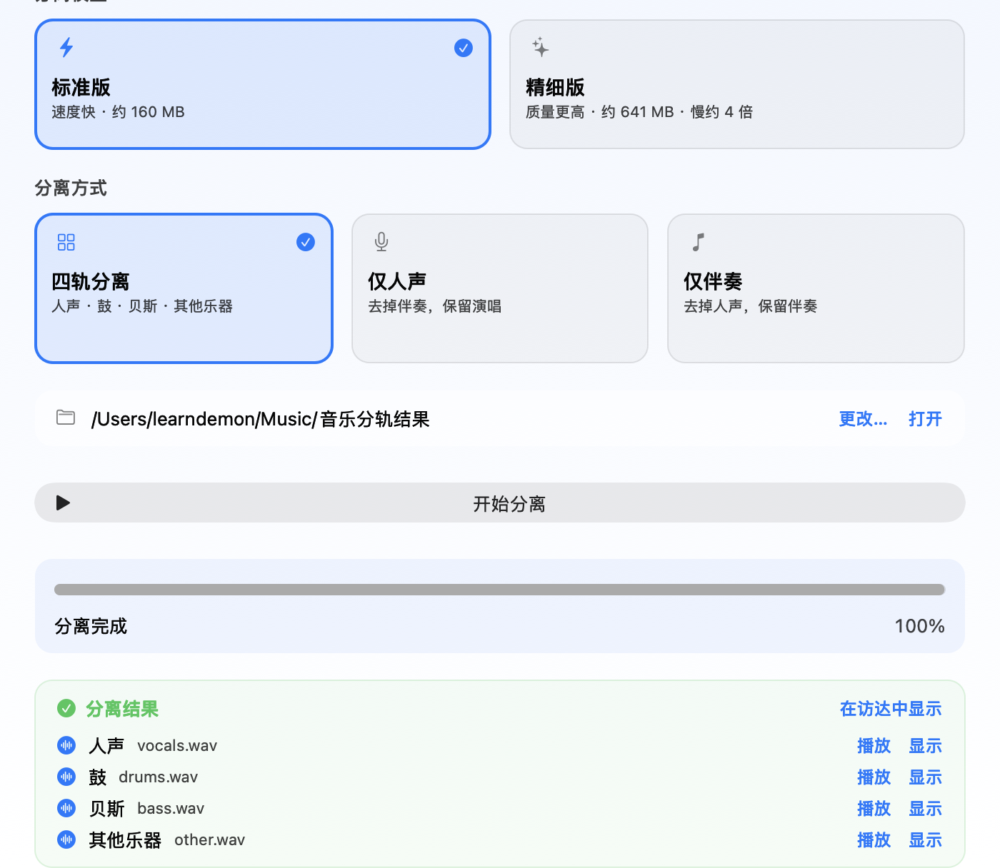

# 音乐分轨（Demucs MLX 图形界面）

一个原生 macOS（AppKit）的 Demucs 图形界面：把音频拖进窗口，选择模型和分离方式，
在本地完成分轨，音频不会上传到任何服务器。



- 原生 AppKit 界面（Swift），不是 Electron 或 Python 套壳
- 基于 Apple MLX，在 Apple Silicon 上运行
- 两种模型可切换：标准版 `htdemucs` / 精细版 `htdemucs_ft`
- 常驻分离引擎复用模型；切换模型、空闲 5 分钟、取消、退出都会释放内存
- 支持拖放、四轨 / 仅人声 / 仅伴奏、实时状态、结果播放

- 应用位置：`~/Applications/音乐分轨.app`
- 源码位置：`~/Documents/音乐分轨`
- 默认输出：`~/Music/音乐分轨结果/<文件名>_<模式>_<模型>_<时间>/`

---

## 一、之前为什么每次都会重新下载模型？

`demucs-mlx` 只认缓存目录里的这两个文件：

```
~/.cache/demucs-mlx/htdemucs.safetensors
~/.cache/demucs-mlx/htdemucs_config.json
```

你机器上原来的情况是：

1. 160 MB 的权重文件确实下载完整了，但被保存成了哈希文件名
   `161f77df...`，而不是 `htdemucs.safetensors`；
2. `htdemucs_config.json` 只有 262 字节，内容是一段
   `Temporary Redirect. Redirecting to ...` 的跳转提示，不是真正的配置。

所以程序每次启动都会判定“缓存不存在 / 不完整”，然后重新下载。

现在已经修复为：

| 文件 | 大小 | SHA-256 |
| --- | --- | --- |
| `htdemucs.safetensors` | 168,005,865 字节 | `339d267a...cd9d297` |
| `htdemucs_config.json` | 4,215 字节 | `23657b19...526b78` |

两个文件都与官方发布值一致。现在运行 `demucs-mlx` 或本应用都不会再触发下载。

> 说明：`python -m demucs_mlx.hub verify ~/.cache/demucs-mlx` 会列出
> `mdx`、`mdx_extra` 等其他模型缺失，这是正常的——你只下载了
> `htdemucs` 和 `htdemucs_ft`，不影响使用。

---

## 二、可选模型

应用里可以自主选择两种模型：

| 模型 | 显示名 | 大小 | 说明 |
| --- | --- | --- | --- |
| `htdemucs` | 标准版 | 约 160 MB | 速度快、内存占用低，单模型 |
| `htdemucs_ft` | 精细版 | 约 641 MB | 4 个模型集成，质量更好，速度约慢 4 倍 |

两个模型都输出同样的四轨（鼓 / 贝斯 / 其他 / 人声），用法一致。

### 内存管理（为什么不会卡）

后端是一个**常驻分离引擎**，模型加载一次后可反复使用。它保证同一时间
内存里只有一个模型：

- 切换到另一个模型时，会**先卸载上一个**（删除引用 + 触发 GC + 清理 MLX 缓存），
  再加载新模型；
- 任务完成后**空闲 5 分钟**自动把模型从内存卸载；
- 点“取消”或退出应用时，会结束引擎进程、彻底释放内存。

底部状态栏会显示「内存中：标准版 / 精细版」，让你知道当前哪个模型占用内存。

### 用 aria2 快速下载模型

你机器上已经有 `aria2c`（`/opt/homebrew/bin/aria2c`），下载大文件比浏览器快得多。
`htdemucs_ft` 已经帮你下好并校验过了，正常情况下无需再下。若以后需要重下：

```bash
mkdir -p ~/.cache/demucs-mlx
cd ~/.cache/demucs-mlx

aria2c -x 16 -s 16 -k 1M --continue=true \
  -o htdemucs_ft.safetensors \
  "https://hf-mirror.com/ssmall256/demucs-mlx/resolve/main/htdemucs_ft.safetensors"

aria2c -x 8 -s 8 \
  -o htdemucs_ft_config.json \
  "https://hf-mirror.com/ssmall256/demucs-mlx/resolve/main/htdemucs_ft_config.json"
```

| 文件 | 大小 | SHA-256 |
| --- | --- | --- |
| `htdemucs_ft.safetensors` | 672,024,519 字节 | `53f03b1a...d7bbabb` |
| `htdemucs_ft_config.json` | 10,253 字节 | `6708535a...a0fa872` |

标准版 `htdemucs` 的下载地址同理：

| 文件 | 大小 | SHA-256 |
| --- | --- | --- |
| `htdemucs.safetensors` | 168,005,865 字节 | `339d267a...cd9d297` |
| `htdemucs_config.json` | 4,215 字节 | `23657b19...526b78` |

> 如果某个模型文件缺失，应用首次运行时会用内置下载器自动补上（国内网络下
> 会自动走 `hf-mirror.com` 镜像），只是比 aria2 慢。

---

## 三、怎么用这个应用

1. 双击 `~/Applications/音乐分轨.app`。
2. 把音频拖进虚线框（也可以点击虚线框选择文件）。
   支持 mp3、wav、m4a、flac、aac、ogg 等常见格式。
3. 选择**模型**：标准版（快）或精细版（质量更高、较慢）。
4. 选择模式：
   - **四轨分离**：输出 `vocals.wav`、`drums.wav`、`bass.wav`、`other.wav`
   - **仅人声**：只输出 `vocals.wav`
   - **仅伴奏**：把鼓、贝斯、其他乐器相加，输出 `instrumental.wav`
5. 点击“开始分离”，等待完成。结束后会自动滚动到结果区域，
   可以点“播放”或“在访达中显示”。

输出统一为 16-bit WAV，采样率 44.1 kHz。

### 小提示

- 第一次运行时模型需要加载和编译，通常会多等几秒；之后会快很多。
- 分离期间可以点“取消”。
- 底部绿点表示本地模型已就绪；橙色表示没找到模型，首次运行会自动下载。
- 如果出现错误，展开“运行日志”可以看到完整的 Python 报错。

---

## 四、环境依赖

- macOS（建议 13 及以上），Apple Silicon（MLX 依赖）
- 已安装 [demucs-mlx](https://github.com/ssmall256/demucs-mlx) 的 Python 环境
- 编译应用需要 macOS Command Line Tools

应用本身只是一个界面，真正干活的是你原来装好的：

```
/opt/anaconda3/bin/demucs-mlx
```

它会自动使用同目录下的 `/opt/anaconda3/bin/python3` 和已安装的 `demucs_mlx`。
如果以后把 conda 环境换到别的位置，可以指定工具路径：

```bash
defaults write local.demucsmlx.musicseparator demucsToolPath \
  "/你的路径/bin/demucs-mlx"
```

然后重新打开应用即可。

如果应用提示“未找到 demucs-mlx”，可以检查：

```bash
/opt/anaconda3/bin/demucs-mlx --list-models
```

---

## 五、重新构建应用

需要 macOS 的 Command Line Tools（你这台机器已经装了，不需要完整 Xcode）：

```bash
cd ~/Documents/音乐分轨
./build.sh
```

构建完成后会自动放到：

```
~/Applications/音乐分轨.app
```

---

## 六、目录说明

```
音乐分轨/
├── build.sh                     # 编译并打包 .app
├── Info.plist                   # 应用信息
├── LICENSE                      # 项目许可证（MIT）
├── NOTICE.md                    # 第三方组件与授权
├── README.md
├── docs/                        # 界面截图
├── Resources/
│   └── gui_backend.py           # 常驻分离引擎（JSON Lines 协议）
└── Sources/
    ├── AppMain.swift            # 程序入口、菜单
    ├── MainViewController.swift # AppKit 界面
    └── SeparationModel.swift    # 引擎进程、日志、进度、模型管理
```

后端核心逻辑在 `Resources/gui_backend.py`：
这是一个常驻的分离引擎，用 `demucs_mlx.api.Separator` 按需加载 `htdemucs`
或 `htdemucs_ft`，同一时间只保留一个模型，切换或空闲时显式卸载。
四轨模式下分别保存四条轨道；伴奏模式则把 `drums + bass + other` 相加，
必要时整体缩放避免削波。

---

## 七、常见问题

### 1. 又不小心删了模型，想手动修复

用 aria2 最快（见上文“用 aria2 快速下载模型”），或者用内置下载器：

```bash
/opt/anaconda3/bin/python -m demucs_mlx.hub download htdemucs htdemucs_ft \
  --output-dir ~/.cache/demucs-mlx
```

它会自动校验大小和 SHA-256。

### 2. 系统提示“无法打开应用”

这是本地自行编译、没有开发者签名的应用。可以在 Finder 里右键应用 →
“打开”，或者执行：

```bash
xattr -cr ~/Applications/音乐分轨.app
```

### 3. 想改界面或加功能

界面在 `Sources/MainViewController.swift`，后端在
`Resources/gui_backend.py` 和 `Sources/SeparationModel.swift`。
改完运行 `./build.sh` 即可。

---

## 八、许可证

本项目代码采用 **MIT** 许可证，见 [LICENSE](LICENSE)。

第三方组件（Demucs、demucs-mlx、MLX、预训练权重）的许可与归属见 [NOTICE.md](NOTICE.md)。
模型权重不随本仓库分发，由 `demucs_mlx` 在首次使用时下载并校验。
